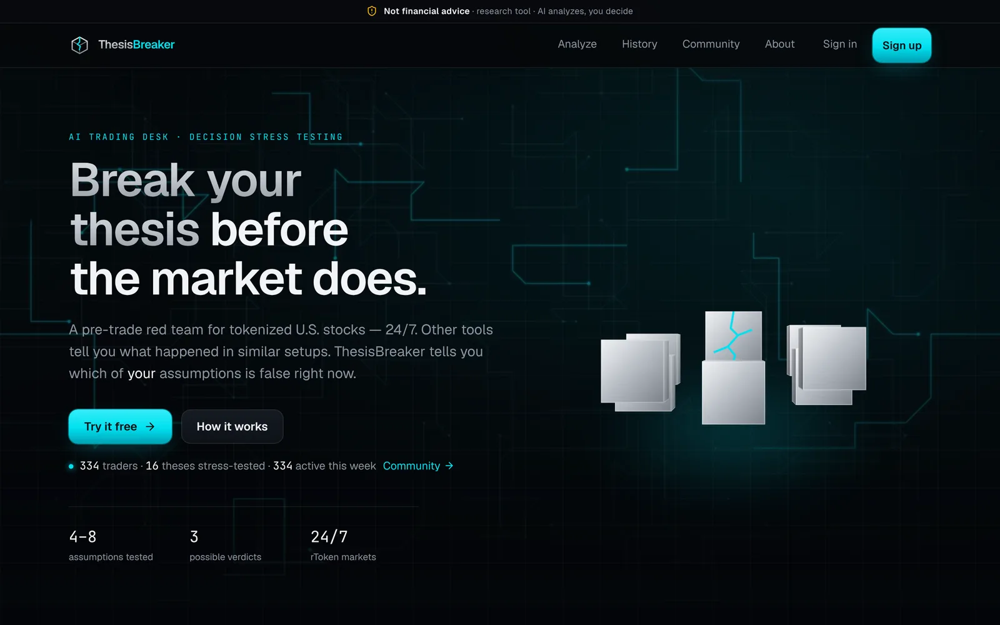
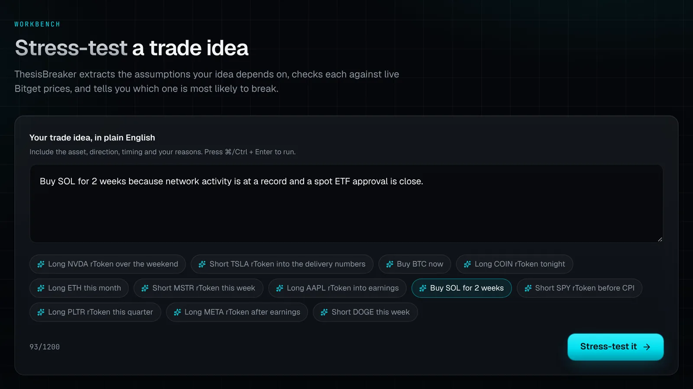
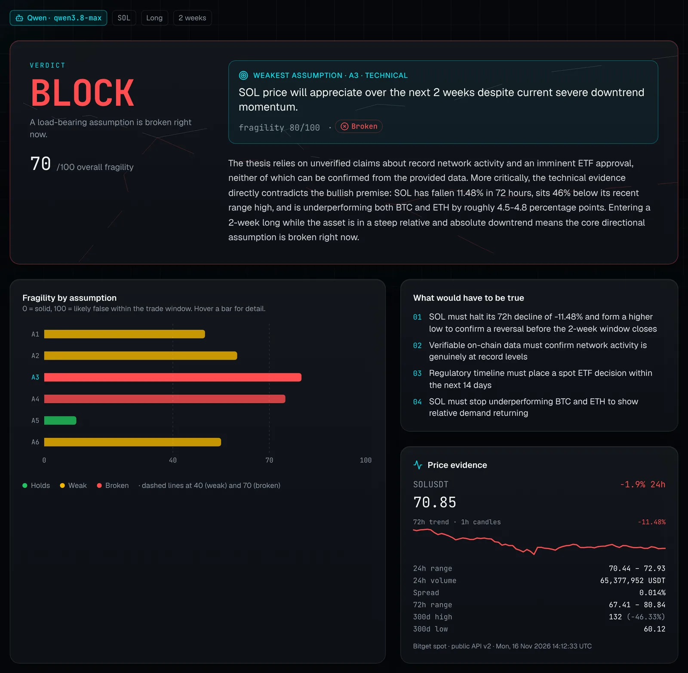
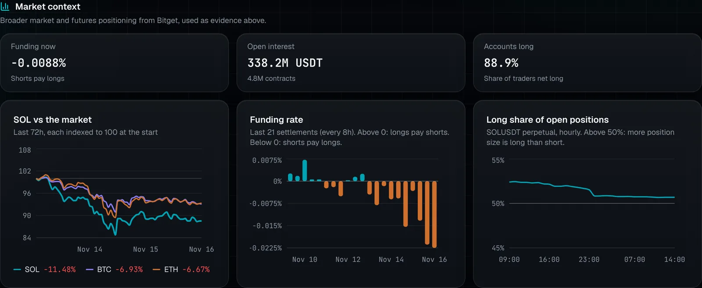
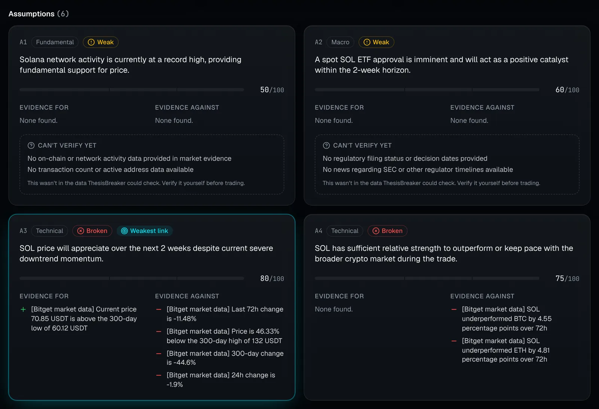
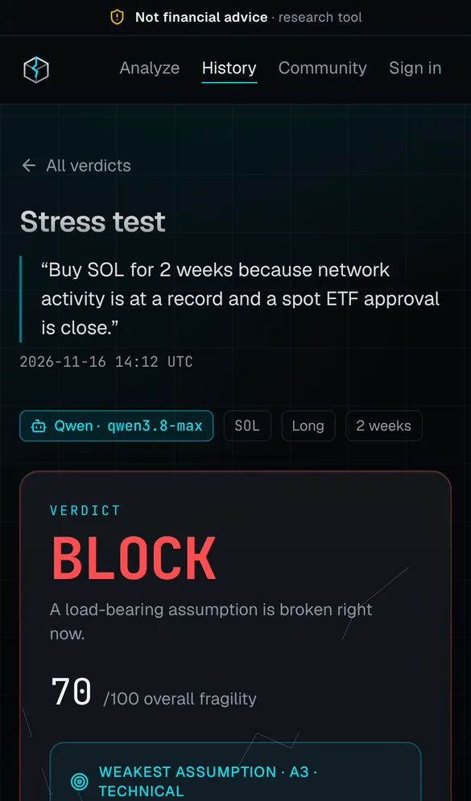
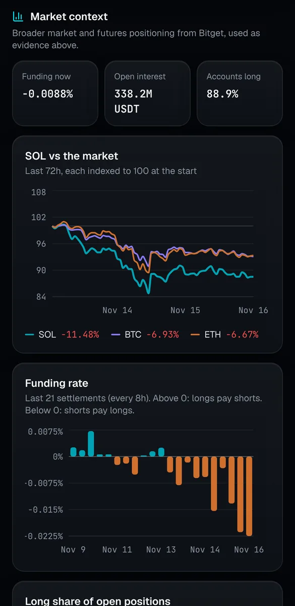
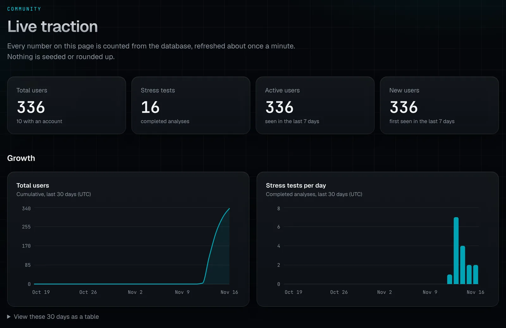

# ThesisBreaker

**Break your thesis before the market does.**

**Live app: [thesis-breaker-sigma.vercel.app](https://thesis-breaker-sigma.vercel.app)**



ThesisBreaker is a pre-trade red team for tokenized U.S. stocks (Bitget rTokens, which trade 24/7) and crypto. You describe a trade idea in plain English. ThesisBreaker finds the hidden assumptions your idea depends on, tests each one against live market evidence, and returns a verdict: **PASS**, **REVISE** or **BLOCK**. The verdict names the assumption most likely to break.

AI analyzes; you decide. ThesisBreaker never places orders. It is a research tool, not financial advice.

Built for the Bitget AI Hackathon S2 (AI Trading Desk → Decision Stress Testing).

This README has two parts:

- **[Part 1: The product](#part-1-the-product)** is for traders, judges and anyone curious. It covers what the product does and why.
- **[Part 2: Running and building it](#part-2-running-and-building-it)** is for developers. It covers setup, configuration and architecture.

---

## Part 1: The product

### The problem

Most trading tools answer *"what happened in similar setups?"* Few answer the question that decides whether a trade works: **which of my own assumptions is false right now?**

Every trade idea rests on a chain of beliefs about fundamentals, price structure, timing, liquidity, macro conditions and sentiment. A trade usually fails at its weakest link, and that link is rarely the one the trader was thinking about. Traders seldom write these beliefs down, so nobody checks them before money is at risk.

Tokenized U.S. stocks make the problem sharper. They trade around the clock, even when the U.S. cash market is closed. That off-hours gap brings in assumptions about price tracking, liquidity and weekend gaps that are easy to miss.

### What ThesisBreaker does

1. **You write the idea the way you'd say it.** For example: *"Long NVDA rToken over the weekend because earnings will beat and the Friday dip will reverse by Monday."*
2. **It pulls live evidence from Bitget.** For the asset you named: the last price, 24h change and range, volume, spread, the last 72 hourly candles and about a year of daily range. For context: how the broader market moved over the same 72 hours (BTC and ETH for crypto, the S&P 500 and Nasdaq-100 rTokens for stocks), and how futures traders are positioned (funding rate, open interest, long/short ratios).
3. **It surfaces 4–8 testable assumptions.** Each one gets evidence for, evidence against, a status (*holds / weak / broken*) and a fragility score from 0 to 100.
4. **It returns a verdict.** PASS, REVISE or BLOCK, along with the weakest assumption and what would have to be true for the trade to work.
5. **It keeps your history.** Every stress test is saved so you can look back at what you believed and what happened.

### A tour of the app

*Screenshots from the live site, taken on 16 November 2026. The example idea is "Buy SOL for 2 weeks because network activity is at a record and a spot ETF approval is close."*

**1. Describe your idea.** Type it in plain English, or start from one of 12 examples.



**2. Get a verdict.** The verdict names the weakest assumption, and an AI summary explains why. The fragility chart scores every assumption from 0 (solid) to 100 (likely false within the trade window).



**3. See the market context.** The result shows how the asset moved against the broader market, the futures funding rate, and how traders are positioned. These are the same numbers the AI used as evidence.



**4. Check every assumption.** Each card lists evidence for and against, tagged by source. Claims ThesisBreaker has no data for, like on-chain activity or ETF decisions, go under **Can't verify yet**, so you know what to check yourself.



**On a phone,** every page and chart fits the small screen:

<p align="center">
  
  &nbsp;&nbsp;
  
</p>

**Community.** `/community` shows live traction counted from the database: users, stress tests, growth over 30 days, the verdict mix and top inviters.



### Why you can trust the output

- **Live data is labeled.** Evidence from Bitget is tagged *[Bitget market data]*. Background knowledge from the model is tagged *[General knowledge]* and may be out of date.
- **Missing data is not counted against you.** If an assumption can't be checked with the available data, it's listed under *Can't verify yet* and marked *weak*, never *broken*. The AI is told never to invent numbers, dates or news.
- **Rules can only make a verdict stricter.** Simple scoring rules can escalate the model's verdict (PASS → REVISE → BLOCK) when assumption scores cross a threshold. They can never soften it.
- **Every model answer is validated.** Each answer is checked against a strict schema before it is shown or saved.
- **It still works offline.** If the AI model is unavailable, a deterministic heuristic produces a clearly labeled "offline heuristic" result instead of failing.

### Accounts and privacy

- **No account needed.** You can use ThesisBreaker without signing up. A single anonymous cookie (a random ID) keeps your stress tests together in your history.
- **Optional sign-in.** You can sign in with Google or an email magic link to keep your history across devices. Stress tests you already ran in that browser carry over to your account.
- **What is stored:** your trade ideas, their analyses, and your email if you sign in. No raw IP addresses are stored, and the site has no ad or third-party trackers.
- **Invite links.** Every account gets a personal invite link and a "My invites" page showing who joined through it and who became active. Emails are never shown to other users.
- **Community page.** `/community` shows live traction: users, stress tests, a 30-day growth chart, the verdict mix, recent members and top inviters. Your name appears there only if you opt in; otherwise you are listed as "Anonymous trader".
- **Public counts are real.** Every number on the landing and community pages comes from real database counts and is never seeded or faked.
- **Privacy and terms.** See `/privacy` and `/terms` on the site.

### What it does *not* do

- It does not tell you to buy or sell anything.
- It does not predict prices. A verdict describes the assumptions in your idea, not the future.
- It does not place trades or connect to your wallet.

---

## Part 2: Running and building it

### Tech stack

Next.js 16 (App Router) · React 19 · Tailwind CSS v4 · Postgres + Drizzle ORM · Auth.js v5 · zod · framer-motion · recharts. AI is Qwen via Bitget's OpenAI-compatible endpoint. Market data comes from Bitget's public spot and USDT-futures APIs (v2), which need no key.

### Quick start

**Prerequisites:**
- Node.js 20.9 or later
- A Postgres database (local, Neon, Supabase or Vercel Postgres all work)

```bash
git clone https://github.com/Eric-65/ThesisBreaker-.git
cd ThesisBreaker-
cp .env.example .env.local      # then fill in at least DATABASE_URL
npm install
npm run db:migrate              # creates the tables from drizzle/*.sql
npm run dev                     # http://localhost:3000
```

Only `DATABASE_URL` is needed to try it. Without a Qwen key, the app runs in **offline heuristic mode**. Without the auth variables, sign-in is hidden and everything works anonymously.

### Environment variables

All variables are read on the server only. None use the `NEXT_PUBLIC_` prefix, so nothing secret reaches the browser.

| Variable | Required? | Purpose |
|---|---|---|
| `DATABASE_URL` | Yes, for history | Postgres connection string. Without it, analysis still runs but nothing is saved. |
| `BITGET_QWEN_API_KEY` | For AI analysis | Key for Bitget's Qwen endpoint. Leave empty to use the offline heuristic. |
| `QWEN_BASE_URL` | No | Defaults to `https://hackathon.bitgetops.com/v1`. |
| `QWEN_MODEL` | No | Defaults to `qwen3.8-max`. |
| `QWEN_ENABLE_THINKING` | No | `true` / `false` (default). Thinking tokens are billed as output. |
| `QWEN_TIMEOUT_MS` | No | Per-request timeout in ms. Defaults to `45000`. |
| `AUTH_SECRET` | For sign-in | Auth.js secret. Generate with `npx auth secret`. |
| `AUTH_GOOGLE_ID` / `AUTH_GOOGLE_SECRET` | For Google sign-in | Google OAuth client ID and secret. Redirect URI: `https://<your-domain>/api/auth/callback/google`. Only the `openid`, `email` and `profile` scopes are requested. |
| `AUTH_RESEND_KEY` / `AUTH_EMAIL_FROM` | Optional | [Resend](https://resend.com) API key and a verified sender, for email magic links. |
| `AUTH_URL` | No | Canonical site URL. Only needed outside Vercel or behind a proxy. |
| `IP_HASH_SALT` | No | Salt for hashed-IP rate-limit keys. Falls back to `AUTH_SECRET`. |
| `ADMIN_TOKEN` | For `/admin` | Unlocks the admin user table. At least 16 characters; without it `/admin` returns 404. |
| `CONTACT_EMAIL` | Recommended | Address shown on `/privacy` and `/terms` for deletion requests. |
| `SITE_URL` | No | Origin used in invite links. Defaults to the live site in production. |

Sign-in turns on only when `AUTH_SECRET`, `DATABASE_URL` and at least one provider (Google or Resend) are all set.

### Deploying to Vercel

1. Import the repository in Vercel.
2. Add the environment variables above under **Project → Settings → Environment Variables**.
3. Run `npm run db:migrate` once against the production `DATABASE_URL`, and again whenever a new migration is added. If you can't run it from a terminal, paste `scripts/sql/production-catch-up.sql` into your database's SQL editor instead.
4. If you use Google sign-in, add the production callback URL to your Google OAuth client.

### Scripts

| Command | What it does |
|---|---|
| `npm run dev` | Start the dev server |
| `npm run build` / `npm start` | Production build / serve |
| `npm run lint` | ESLint |
| `npm run typecheck` | TypeScript, no emit |
| `npm run db:generate` | Generate a migration after editing `src/db/schema.ts` |
| `npm run db:migrate` | Apply pending migrations |
| `npm run images` | Regenerate the procedural brand images in `public/images/` (see `CREDITS.md`) |

### How it works

```
Browser ──POST /api/analyze──▶ rate limit ─▶ identify visitor/user
                                   │
                                   ▼
        parse idea ─▶ 24h cache ─▶ Bitget market data ─▶ Qwen (streamed, zod-validated)
                                                              │  (on failure: offline heuristic)
                                                              ▼
                                        verdict guardrail ─▶ save to Postgres ─▶ result
        ◀────────────── Server-Sent Events: step progress, evidence, model output, final result
```

- **Streaming:** `POST /api/analyze` streams Server-Sent Events, so the UI shows each stage live.
- **Caching:** the same idea run within 24 hours reuses the earlier Qwen result, which saves credits. Token usage for every call, including cache hits, is logged in `qwen_calls`.
- **Symbol lookup:** symbols are resolved against Bitget's live symbol list. They are never guessed.
- **Evidence gathered for each idea** (all from Bitget's public API, no key needed):
  - the asset's price, 24h stats, last 72 hourly candles and about a year of daily range;
  - the broader market over the same 72 hours: BTC and ETH for crypto, the SPY and QQQ rTokens for stocks;
  - futures positioning on the asset's USDT perpetual: funding rate (now and the last 21 settlements), open interest, and long/short ratios by position size and by account.
- **"Can't verify yet":** when checking an assumption needs data ThesisBreaker doesn't fetch (on-chain activity, news, ETF or SEC decisions, earnings dates), the AI lists it separately instead of counting it as evidence against. These items are stored in `assumptions.evidence_against` with a `[Can't verify] ` tag, so no migration was needed.
- **Charts:** the result page shows the asset against the benchmarks (indexed to 100), the funding-rate history, and the long share of open positions.

### Project layout

| Path | Responsibility |
|---|---|
| `src/app/` | Pages (`/`, `/analyze`, `/history`, `/community`, `/invites`, `/profile`, `/signin`, `/admin`, `/privacy`, `/terms`, `/about`) and API routes |
| `src/app/api/analyze` | The streaming stress-test endpoint |
| `src/app/api/stats` | Public community stats (totals, 30-day growth, verdict mix, recent members, top inviters), cached 60s |
| `src/lib/stats.ts` | The cached COUNT queries behind `/api/stats`, `/community` and the homepage strip |
| `src/lib/referrals.ts` | Invite codes, referral crediting rules and the "My invites" data |
| `src/lib/admin.ts` | `ADMIN_TOKEN` check and the admin session cookie |
| `src/lib/analysis/run.ts` | Orchestration of the full stress test |
| `src/lib/analysis/scoring.ts` | Fragility scoring and the verdict guardrail |
| `src/lib/analysis/heuristic.ts` | Deterministic offline fallback |
| `src/lib/qwen.ts` | `fetch`-based Qwen client: JSON mode, streaming, timeout, one retry on 5xx |
| `src/lib/market/` | `MarketDataProvider` interface, Bitget spot v2 implementation, benchmarks (`index.ts`) and futures positioning (`derivatives.ts`) |
| `src/components/results/` | Result page: verdict, fragility chart, assumption cards, price evidence and the Market context charts |
| `src/proxy.ts` | Anonymous visitor cookie and visit tracking (bots skipped) |
| `src/auth.ts` | Auth.js config: Google and magic link, anonymous-to-account merge, referral credit on account creation |
| `src/db/schema.ts` | Drizzle schema: `users`, `theses`, `assumptions`, `qwen_calls`, auth tables |
| `drizzle/` | SQL migrations |
| `scripts/sql/production-catch-up.sql` | Applies all migrations from a database console (e.g. Neon's SQL Editor) when you can't run `npm run db:migrate` |
| `docs/images/` | README screenshots |

### Users, history and limits (technical details)

- **Anonymous visitors.** Each browser gets an httpOnly, `SameSite=Lax` cookie `tb_vid` holding a random UUID that lasts one year. The cookie is also `Secure` in production. A new visit starts after 30 minutes of inactivity, and `visit_count` goes up at most once per 30 minutes (enforced in SQL).
- **Ownership.** Each saved analysis belongs to a `users` row. `/history` shows only the current visitor's or account's analyses. Individual verdict pages (`/history/<id>`) can be shared by link.
- **Sign-in merge.** A first sign-in attaches the email to the existing anonymous row, so the user id stays the same. Signing in from another browser moves that browser's anonymous analyses onto the account. Signing out gives the browser a new anonymous ID.
- **Rate limits on `/api/analyze`.** Each visitor gets 6 per minute and each salted IP hash gets 20 per minute; both limits are kept in memory. A cap of 30 per hour per visitor is counted in Postgres, so it holds across serverless instances.

### Invites, community and admin (technical details)

- **Invite codes.** Each account gets a unique 7-character `referral_code` when it is created, from an alphabet without look-alike characters (no `0/O/1/I/L`). The link is `https://<site>/?ref=CODE`.
- **Capture.** Landing with `?ref=CODE` stores the code in an httpOnly `tb_ref` cookie for 30 days, so it survives the Google redirect.
- **Credit.** The referrer is credited only in the Auth.js `createUser` event, when the invited person creates an account. `referred_by_user_id` is written once and never changed. Unknown codes and self-referrals are ignored, and an existing account cannot be re-referred.
- **Active referral.** An invited account that has completed at least one stress test.
- **Community wall.** `display_name` and `show_on_wall` (off by default) control what is public. Without opt-in a member appears as "Anonymous trader" with no photo.
- **Internal users.** Rows flagged `is_internal` in `/admin`, along with their stress tests and referrals, are excluded from every public number and the leaderboard.
- **Admin.** `/admin` asks for `ADMIN_TOKEN` and then sets an httpOnly session cookie scoped to `/admin`. Every admin action re-checks it on the server.
- **Naming.** In the `users` table, `visitor_id` is the anonymous ID and `image` is the avatar URL (Auth.js requires that name). Analyses are stored in `theses`.

### Testing the referral flow

1. Sign in as user A and open **My invites** from the avatar menu. Copy the invite link.
2. Open the link in a private window (or another browser). The `tb_ref` cookie is set.
3. In that window, sign up as user B with a different Google account or email.
4. Refresh A's **My invites**: B appears under "People joined" with "No stress test yet".
5. As B, run one stress test. Refresh A's page: B is now "Active" and the stress-test count is 1.
6. To appear on `/community`, set a display name and tick "Show me on the community wall" in **Profile**. Public stats refresh within about a minute.

### Credits and disclaimer

See [`CREDITS.md`](CREDITS.md) for image, icon and font sources.

ThesisBreaker is a research tool, not financial advice. Model output can be wrong, incomplete or out of date. Tokenized stocks and crypto are volatile. You are responsible for every trading decision you make.
